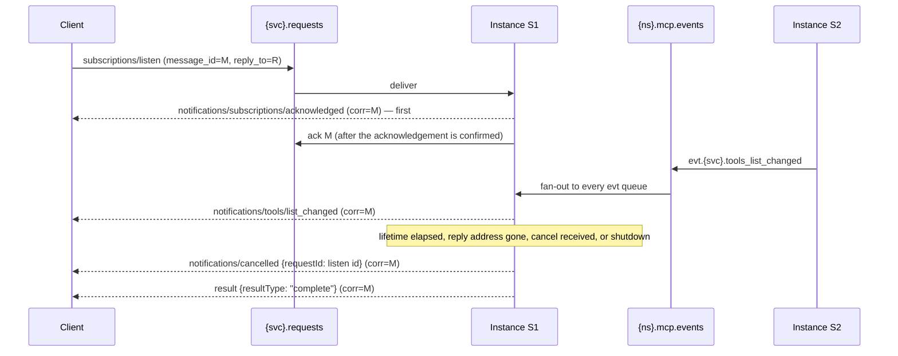

# MCP over AMQP: binding specification

- **Status:** Draft. It becomes normative for this package when two things are true:
  - the maintainer ratifies decision D-1 of
    [REARCHITECTURE_PLAN_2026-07-28.md](./REARCHITECTURE_PLAN_2026-07-28.md);
  - v2.0.0 implements it.

  Until then, it describes the target, not the code. Version 1.x stays governed by
  [TRANSPORT_CONTRACT.md](./TRANSPORT_CONTRACT.md), and nothing here changes 1.x behaviour.
- **Date:** 2026-10-25
- **Protocol:** MCP 2026-07-28 ("modern era"). §11 also covers serving 2025-11-25 clients ("legacy
  era") alongside it.
- **Profiles:**
  - AMQP 0-9.1 on RabbitMQ 4.x is the primary profile, §4–§10.
  - AMQP 1.0 is mapped to OASIS *MCP over AMQP 1.0* CSD01 and *JSON-RPC 2.0 over AMQP 1.0* CSD01
    in §12.
- **Why this document exists:** MCP 2026-07-28 `/basic/transports` says custom transports MUST
  preserve the JSON-RPC message format, the message patterns and the per-request metadata model.
  It says they SHOULD document their connection establishment, message framing and cancellation.
  It also says a binding that mirrors body fields into envelope metadata defines how mismatches
  are rejected. This document does all of that for AMQP.

## 1. Scope

This document defines:

- how MCP 2026-07-28 JSON-RPC messages map to AMQP messages;
- the broker topology a server pool and its clients use;
- correlation, cancellation, ordering, delivery and failure semantics;
- how the principal is derived for authorization.

It does not define:

- the MCP protocol itself;
- broker authentication mechanisms, beyond requiring one (§9);
- the Tasks extension's job transport. That is `@nagual69/amqp-mcp-edge`'s envelope contract, and
  a later revision maps it here (plan §5.10).

Where this document and the OASIS drafts overlap, the OASIS text is the reference, and §12
records each correspondence. Where they diverge, §12 says so and gives the reason.

## 2. Conventions and terms

The key words **MUST**, **MUST NOT**, **REQUIRED**, **SHALL**, **SHALL NOT**, **SHOULD**,
**SHOULD NOT**, **RECOMMENDED**, **MAY** and **OPTIONAL** are to be interpreted as described in
BCP 14 (RFC 2119, RFC 8174), when, and only when, they appear in all capitals.

| Term | Meaning |
|---|---|
| **Client** | An MCP client that sends requests over this binding. |
| **Server instance** | One process that consumes requests for a logical server. |
| **Pool** | All server instances serving one logical server name `{svc}`. A pool MAY have one member. |
| **Request** | A JSON-RPC request object: it has an `id`. |
| **Notification** | A JSON-RPC request object without an `id`. |
| **Exchange record** | The state an instance holds for one request between consume and terminal response (§6.1). |
| **Reply address** | The queue named in a request's `reply_to`. Every message about that request goes there. |
| **Principal** | The broker-validated identity of a message's publisher (§9.1). |
| **Mirror** | An envelope field whose value is copied from the body (§8). |

These are the placeholders used in names:

| Placeholder | Meaning | Constraint |
|---|---|---|
| `{ns}` | Deployment namespace (1.x `exchangeName`) | `^[a-z0-9][a-z0-9_-]{0,62}$`. No dots, so routing keys parse unambiguously. |
| `{svc}` | Logical server name; one per homogeneous pool | Same constraint as `{ns}` |
| `{instance}` | Server-instance id | Unique per process start. Opaque; it never appears in a message body. |
| `{method}` | JSON-RPC method with every `/` replaced by `.` | For example, `tools/call` becomes `tools.call` |

## 3. Design invariants

Every normative rule below exists to keep one of these true. The test pins in plan §8 (P1–P12)
carry them.

| # | Invariant |
|---|---|
| I1 | **The body is authoritative.** An AMQP body is exactly one unmodified JSON-RPC message. No layer rewrites a JSON-RPC `id`. |
| I2 | **Correlate by request identity, never by body id.** Every server message about request R goes to R's reply address, with `correlation_id` equal to R's `message_id`. No shared structure is keyed by a client-chosen JSON-RPC `id`. |
| I3 | **No cross-client delivery.** A message about request R reaches only R's reply address. |
| I4 | **Any instance, any request.** No request depends on state held only by the instance that served an earlier one. |
| I5 | **Everything is bounded.** Requests have deadlines, listen streams have lifetimes, queues have bounds, and every undeliverable message has a defined fate. |
| I6 | **Mirrors are checked.** A mirror that disagrees with the body is rejected and never dispatched. |
| I7 | **The principal comes from the broker.** Authorization uses a broker-validated identity, never a sender-declared one. |
| I8 | **One reply channel per request, in order.** All messages for a request leave on one channel, in the order MCP requires. |

## 4. Topology (AMQP 0-9.1 profile)

### 4.1 Objects

| Object | Type and arguments | Declared by | Bindings |
|---|---|---|---|
| `{ns}.mcp` | topic exchange, durable | server instance | — |
| `{ns}.{svc}.requests` | **quorum** queue, durable. `x-delivery-limit: 3`, `x-dead-letter-exchange: {ns}.mcp.dlx`, `x-max-length: <N>`, `x-overflow: reject-publish` | server instance | `{ns}.mcp`, key `req.{svc}.#` |
| `{ns}.{svc}.ctl.{instance}` | classic queue, exclusive, auto-delete | server instance | `{ns}.mcp`, key `ntf.{svc}.#` |
| `{ns}.mcp.events` | topic exchange, durable | server instance | — |
| `{ns}.{svc}.evt.{instance}` | classic queue, exclusive, auto-delete | server instance | `{ns}.mcp.events`, key `evt.{svc}.#` |
| `{ns}.mcp.dlx` | topic exchange, durable | server instance | — |
| `{ns}.mcp.dead` | quorum queue, durable. `x-max-length` and `x-message-ttl` set by the deployment | server instance | `{ns}.mcp.dlx`, key `#` |
| reply address | RabbitMQ direct reply-to (`amq.rabbitmq.reply-to`), or a client-declared exclusive, auto-delete queue | client | none (default exchange) |
| `{ns}.mcp.routing` | topic exchange, durable. The 1.x exchange, legacy era only (§11). | server instance | — |

Rules:

1. A server instance **MUST** declare every object it uses, with exactly the arguments above. A
   declaration that fails with `PRECONDITION_FAILED` means two pool members disagree on topology.
   That is a deployment error, and the instance **MUST** fail to start rather than run with a
   different queue shape.
2. A client **MUST NOT** declare, bind or delete any server-side object. In a least-privilege
   deployment, a client needs only write access to `{ns}.mcp` and read access to its own reply
   address (§9.3).
3. The request queue is a quorum queue so that queued requests survive the loss of any one
   instance or broker node.
   - RabbitMQ 4.x defaults quorum queues to a delivery limit of 20. This binding sets 3 explicitly,
     so a poison message is dead-lettered after three attempts rather than twenty.
   - Per-message TTL comes from `expiration` (§7.1). The request queue **MUST NOT** declare
     `x-message-ttl`: a queue-wide TTL cannot express per-request deadlines.
4. `x-overflow: reject-publish` makes a full request queue refuse new requests (`basic.nack` to a
   confirming publisher) instead of growing without bound or silently dropping the oldest.
   - Dead-lettering is at-most-once, the quorum-queue default. A deployment **MAY** set
     `x-dead-letter-strategy: at-least-once`, which RabbitMQ only permits together with
     `reject-publish`.
5. Requests compete; client notifications fan out. Each request reaches exactly one instance,
   through the shared quorum queue. Each client notification reaches every instance, through its
   control queue. §6.4 depends on the fan-out.
6. A pool **MUST** be homogeneous. Every instance serves the same tools, resources and prompts,
   with the same schemas, under the same `{svc}`.
   - `server/discover`, `tools/list`, `resources/list` and `prompts/list` **MUST NOT** vary by
     instance. They MAY vary by principal.
   - A deployment that routes some tools to a separate pool exposes that pool under its own `{svc}`.

### 4.2 Routing keys

| Message | Exchange | Routing key |
|---|---|---|
| Request, method other than `tools/call` | `{ns}.mcp` | `req.{svc}.{method}` |
| Request, `tools/call` | `{ns}.mcp` | `req.{svc}.tools.call.{params.name}` |
| Client notification | `{ns}.mcp` | `ntf.{svc}.{method}` |
| Server message (response or notification) | default exchange (`""`) | the request's `reply_to`, verbatim |
| Change event (server to server) | `{ns}.mcp.events` | `evt.{svc}.{kind}` (§6.5) |

The tool-name suffix lets a deployment authorize tools at the broker with RabbitMQ topic
permissions (§9.3). It works only because the server re-derives the key from the body and rejects
any difference (§8).

- A tool name can be carried in a routing key only if:
  - it matches `^[A-Za-z0-9_.-]{1,128}$`, which is the MCP tool-naming guidance;
  - the whole key fits in 255 bytes.
- For a tool name that cannot be carried, the key is `req.{svc}.tools.call` with no suffix.
  - The fallback fails closed. A client whose topic permission lists specific tool keys cannot
    publish the suffix-less key, so it cannot call such a tool.
  - Servers **SHOULD** register only tool names that can be carried.

## 5. Message mapping

### 5.1 Body

1. A body is exactly one JSON-RPC 2.0 message, serialised as UTF-8 JSON text and carried octet for
   octet (I1).
2. `content_type` **MUST** be `application/json`. `content_encoding` **MUST** be absent.
3. Batches (a JSON array body) **MUST NOT** be sent. MCP 2026-07-28 does not support JSON-RPC
   batching. A server that receives an array answers per §7.4 with `-32600`.
4. A response or notification **MUST** be sent byte for byte as the serving engine produced it.
   No transport layer adds, removes or renames body fields.

### 5.2 Properties and headers

| Field (0-9.1) | Request | Client notification | Server response or notification |
|---|---|---|---|
| `message_id` | **MUST.** Globally unique; a UUID is RECOMMENDED. Never reused, including on retry. | **MUST** | **MUST**, new per message |
| `reply_to` | **MUST** | **MUST NOT** | absent |
| `correlation_id` | **MUST NOT** (the modern era; §11 covers legacy) | **MUST NOT** | **MUST** equal the request's `message_id`, byte-identical |
| `user_id` | **MUST** (§9.1) | **MUST** | **MUST** (the server's own principal) |
| `expiration` | **MUST.** The remaining deadline in ms, as a decimal string (§7.1). | SHOULD, for example 30000 | listen stream messages: MAY |
| `timestamp` | SHOULD (seconds since the epoch) | SHOULD | SHOULD |
| `delivery_mode` | 2 (persistent) | 1 | 1 |
| `content_type` | `application/json` | same | same |
| `app_id` | MAY (client software id, for operators) | MAY | MAY |
| header `mcp-protocol-version` | **MUST** mirror `params._meta["io.modelcontextprotocol/protocolVersion"]` | MUST mirror it if the body carries it | absent |
| header `mcp-method` | **MUST** mirror `method` | **MUST** mirror `method` | absent |
| header `mcp-name` | **MUST** mirror `params.name` for `tools/call` and `prompts/get`, and `params.uri` for `resources/read`. Absent otherwise. | absent | absent |
| header `mcp-request-message-id` | absent | **MUST** on `notifications/cancelled`: the cancelled request's `message_id` (§6.4) | absent |
| headers `traceparent`, `tracestate` | SHOULD mirror the corresponding `_meta` keys when present | same | SHOULD propagate |

Header values are AMQP long strings holding UTF-8 text. Unlike the HTTP binding's `Mcp-Name`, this
binding does **not** apply a `=?base64?…?=` encoding to non-ASCII values: AMQP field tables carry
arbitrary UTF-8. A mirror holds the exact body string.

Publish flags:

- Every publish **MUST** set `mandatory: true` (§7.3).
- `immediate` is unsupported by RabbitMQ and **MUST NOT** be set.

This binding defines no `Mcp-Param-*` equivalent. A server **MUST NOT** require parameter mirrors
over AMQP, even for tools whose schema declares `x-mcp-header`, because that requirement belongs
to the Streamable HTTP binding.

## 6. Message patterns

### 6.1 Request and response

1. An instance consumes a request from `{ns}.{svc}.requests`.
2. It validates the message (§7.4) and checks every mirror (§8).
3. It creates an exchange record:
   `{principal, messageId, replyTo, deadline, redelivered, abort: AbortController}`.
4. It dispatches the body to its serving engine, with `authInfo` derived from the principal
   (§9.2).
5. Every message the engine emits for that request goes to `replyTo` with
   `correlation_id = messageId`, on the instance's reply channel, in emission order (I2, I8). This
   includes `notifications/progress`, `notifications/message`, and the terminal response.
6. When the terminal response is publisher-confirmed, the instance acks the delivery (§7.2) and
   discards the exchange record.

Rules:

- A server **MUST NOT** send `notifications/message` for a request whose `_meta` lacks
  `io.modelcontextprotocol/logLevel`. This is MCP 2026-07-28's rule, restated here because the 1.x
  transport broadcast log messages.
- A server **MUST NOT** publish a request-scoped message anywhere but that request's reply address.
  There is no broadcast in the modern era (I3).
- A server **MUST NOT** send JSON-RPC requests to a client. Input the server needs from the client
  is obtained by MRTR (§6.2). This binding has no server-to-client request path.

### 6.2 Multi round-trip requests (MRTR)

- An `InputRequiredResult` is an ordinary terminal response.
- The client's retry is a new request:
  - it has a new JSON-RPC `id` and a new `message_id`;
  - it is not correlated with the original;
  - it MAY be consumed by any instance (OASIS MCP-AMQP §6.2).

Pool requirements, all of which follow from I4:

1. Every instance **MUST** be able to verify a `requestState` that any other instance produced.
   With the SDK's `createRequestStateCodec`, that means one HMAC key shared by the whole pool,
   with key ids so it can be rotated.
2. `requestState` **SHOULD** be bound to:
   - the principal;
   - the originating method and `params.name` or `params.uri`;
   - an expiry.

   A retry from a different principal **MUST** fail verification.
3. A per-instance random key is non-conformant for any pool with more than one member. It passes
   every single-instance test and fails in production, which is why pin P10 runs two instances.

### 6.3 `subscriptions/listen`



1. **Order.**
   - `notifications/subscriptions/acknowledged` **MUST** be the first message the server sends for
     the stream.
   - Every message on the stream goes to the listen request's reply address, with `correlation_id`
     set to its `message_id`, on one channel (I8). This is OASIS MCP-AMQP §6.3 and §9.
   - The SDK stamps `io.modelcontextprotocol/subscriptionId` in `_meta`. The transport neither adds
     nor alters it.
2. **Ack timing.**
   - The listen delivery is acked once the acknowledgement notification is publisher-confirmed,
     not at stream end. Holding the delivery unacked for the stream's life would pin a prefetch
     slot.
   - It would also make the broker redeliver the listen to another instance after a crash, which
     the client cannot tell apart from a duplicate.
   - A client that loses a stream re-listens (item 6).
3. **Lifetime.**
   - A server **MUST** bound each stream's lifetime (OASIS MCP-AMQP §8).
   - The default is `maxListenMs = 900000` (15 minutes). OASIS requires a bound but does not fix
     a value; 15 minutes is this binding's choice.
   - A client **MAY** request a shorter bound by setting `expiration` on the listen request. The
     server uses the smaller of the two.
4. **Server-initiated end.** On lifetime expiry, an undeliverable reply address (§7.3), or
   shutdown, the server:
   1. **MUST** send `notifications/cancelled` with `requestId` set to the listen request's `id`
      (MCP 2026-07-28 `/basic/patterns/cancellation`);
   2. **SHOULD** then send the `subscriptions/listen` result with `resultType: "complete"` (OASIS
      MCP-AMQP §8);
   3. **MUST** send nothing further for the stream.

   Both messages go on the stream's channel, in that order.
5. **Client view of the end.**
   - The `complete` result is the terminal message.
   - A server-sent `notifications/cancelled` for the listen means the stream is ending. A client
     that receives it and no `complete` result within a short grace period (RECOMMENDED: 5 s)
     **MUST** treat the stream as ended.
   - A client **MUST NOT** answer a server-sent cancellation with a cancellation of its own.
6. **Client-initiated end.**
   - A client ends a stream by sending `notifications/cancelled` for the listen request, per §6.4.
   - The server then stops the stream, **MUST NOT** send further notifications on it, and
     **SHOULD NOT** send a result. This is the rule MCP sets for any cancelled request.
7. **Re-listen.**
   - The server holds no subscription state beyond the stream, so a client whose stream ends for
     any reason re-sends `subscriptions/listen`.
   - A client that sees its reply channel close **MUST** treat every stream on it as ended.

### 6.4 Cancellation

AMQP has no per-request stream whose closure could signal cancellation, so this binding uses the
stdio rule:

- A client **MUST** send `notifications/cancelled` with `requestId` set to the request's JSON-RPC
  `id` when it abandons a request.
- That includes abandoning it because the request's deadline passed (OASIS MCP-AMQP §8).

The problem is affinity. With competing consumers (§4.1 rule 5), a cancellation sent to the
request queue would reach an arbitrary instance, and the body `requestId` alone is not a safe key,
because every client numbers its ids from the same start. This binding therefore defines the
following:

1. The client publishes the cancellation to `{ns}.mcp` with key
   `ntf.{svc}.notifications.cancelled`. It fans out to every instance's control queue.
2. The client sets header `mcp-request-message-id` to the cancelled request's `message_id`.
   - That value is globally unique, so it identifies exactly one exchange record anywhere in the
     pool.
   - The client keeps a map from JSON-RPC `id` to `message_id` for each request in flight, for
     exactly this purpose.
3. Each instance matches as follows:
   - **Header present:** it looks up the exchange record by `(principal, mcp-request-message-id)`.
   - **Header absent** (a client implementing only OASIS): it falls back to
     `(principal, params.requestId)` and accepts the ambiguity that this key carries.
   - **In both cases** the principal is the cancellation's broker-validated `user_id` (§9.1). An
     instance **MUST NOT** act on a cancellation whose principal differs from the request's, so
     client A can never cancel client B's `id: 1`.
4. On a match, the instance aborts the exchange's signal. It **SHOULD NOT** send a response for the
   cancelled request. It acks the request's delivery once the engine has released the exchange.
5. **A cancellation that arrives before its request.** Each instance keeps a record of every
   cancellation it receives that matches nothing, for the longest permitted request deadline. A
   request consumed later whose `(principal, message_id)` is in that record is acked and dropped,
   with no response, because its client has already given up. The record **MUST** be bounded in
   size and **SHOULD** report evictions.
6. A cancellation that matches nothing and is never followed by its request is discarded silently
   when its record entry expires. MCP permits ignoring unknown cancellations.

### 6.5 Change events between instances

- A server instance publishes a list or resource change as a **change event**:
  - exchange `{ns}.mcp.events`;
  - key `evt.{svc}.{kind}`;
  - body the SDK `ServerEvent` JSON: `{"kind": "tools_list_changed" | "prompts_list_changed" |
    "resources_list_changed"}`, or `{"kind": "resource_updated", "uri": "<uri>"}`.
- Change events are server-to-server. They are not MCP messages and never reach a client.
- An instance **MUST** deliver change events to its own open streams only through its event queue,
  never directly in-process. That gives one path, one order and no double delivery.
- The SDK's listen router does the per-stream filtering and stamping.
- Event queues are deliberately non-durable. A missed `*_list_changed` heals at the client's next
  list call, and the `ttlMs` cache bound limits how stale it can get.

### 6.6 `server/discover`

`server/discover` is an ordinary request. Any instance answers it, and the answer **MUST** be the
same across the pool (§4.1 rule 6).

## 7. Delivery

### 7.1 Deadlines

1. A client **MUST** set `expiration` on every request to its remaining wait time, so the broker
   discards a request before dispatch once its client has stopped waiting.
2. The server derives the exchange deadline from `expiration`, measured from consume time, and
   aborts the exchange when the deadline passes.
3. A request consumed with less than `minUsefulMs` (default 250 ms) remaining is dead-lettered with
   reason `deadline-exceeded` and not dispatched.
4. The client's own timeout is authoritative. When it fires, the client sends the cancellation
   (§6.4), whatever the server is doing.

### 7.2 Acknowledgement and redelivery

1. **Prefetch is concurrency.** An instance consumes requests with manual acknowledgement and a
   `basic.qos` prefetch equal to the number of requests it will run at once.
2. **Ack on completion.** A request is acked only after its terminal response is
   publisher-confirmed. The two exceptions are listen requests (§6.3, item 2) and requests dropped
   under §6.4, item 5.
3. **Redelivery and side effects.** When a delivery has `redelivered = true`:
   - **Re-executed:** a method other than `tools/call`, and a `tools/call` for a tool annotated
     `readOnlyHint: true` or `idempotentHint: true`.
   - **Refused:** any other `tools/call`. The server answers it with:

     ```json
     {"code": -32603, "message": "Request was redelivered; the tool is not idempotent",
      "data": {"reason": "redelivered-non-idempotent"}}
     ```

     It then acks. It does not re-run a side effect that may have half happened.
   - MCP's own tool annotations are the idempotency contract. Without a pool-wide dedup store,
     nothing stronger is available.
4. **Optional same-instance dedup.** An instance **MAY** keep a bounded LRU of `message_id`s it
   has answered and drop a repeat, per the OASIS JSON-RPC-AMQP §8 SHOULD.
5. **Client notifications** on the control queue are acked on receipt. Losing one costs, at worst,
   a cancellation that MCP already treats as best-effort.

### 7.3 Replies and returns

1. **One reply channel per request.** An instance publishes replies on a channel in confirm mode.
   - All messages for one request **MUST** use the same channel (I8).
   - One channel per instance satisfies this. A pool of channels with per-request affinity also
     satisfies it.
2. **Returned replies.** Replies are published `mandatory: true`. A `basic.return` with reply code
   312 (`NO_ROUTE`) means the reply address is gone. The instance then:
   - aborts the exchange;
   - ends any listen stream with no further sends;
   - acks the request.

   OASIS JSON-RPC-AMQP §9 says a responder that learns it cannot deliver SHOULD stop processing.
   This is how a 0-9.1 responder learns it.
3. **Direct reply-to.** Whether RabbitMQ 4.x returns, or silently discards, a publish to a stale
   `amq.rabbitmq.reply-to` address is **unverified** (O-2). Until it is verified:
   - a client **SHOULD** use a named exclusive reply queue for `subscriptions/listen`, where a
     return is certain;
   - direct reply-to is RECOMMENDED for ordinary requests, because losing replies with the channel
     matches MCP 2026-07-28's removal of resumability;
   - a client that uses direct reply-to **MUST** consume it in no-ack mode on the channel that
     publishes the requests, as RabbitMQ requires.
4. **Backpressure.** When `publish` returns `false`, the instance waits for `drain`, with a
   timeout, before publishing more. When the timeout expires, it aborts the exchange.

### 7.4 Invalid and undeliverable input

A message is **addressable** if it has both `message_id` and `reply_to`. For an addressable
message, the error response goes to `reply_to` with `correlation_id = message_id`, and `id` is the
body's `id`, or `null` if that cannot be read (OASIS JSON-RPC-AMQP §6.5).

To **dead-letter** a message, the server:

1. publishes a copy to `{ns}.mcp.dlx` with routing key `dead.{svc}.{reason}`, the original
   properties, and header `x-mcp-reject-reason: {reason}`;
2. waits for that publish to be confirmed;
3. acks the original.

Dead-lettering is done this way, not by rejecting without requeue, because a broker-side
dead-letter cannot carry a reason the server chose. Broker-side dead letters (delivery limit,
expiry) arrive with RabbitMQ's own `x-death` header instead.

| Condition | Response, if addressable | Fate | Reason |
|---|---|---|---|
| Body over `maxMessageSize` (default 1 MiB) | `-32600`, `id: null`, `data.reason: "message-too-large"`; the body is not parsed | dead-letter | `message-too-large` |
| Not UTF-8, or not JSON | `-32700`, `id: null` | dead-letter | `parse-error` |
| JSON, but not a JSON-RPC request object; or a batch | `-32600` | dead-letter | `invalid-request` |
| Request without `message_id` or without `reply_to` | none (it cannot be answered) | dead-letter | `unaddressable` |
| Notification with `reply_to` set | none (a notification is never answered) | dead-letter | `invalid-notification` |
| `user_id` absent | `-32600`, `data.reason: "principal-required"` | dead-letter | `principal-required` |
| A mirror that disagrees with the body, or a required mirror that is missing (§8) | `-32020` | dead-letter | `mirror-mismatch` |
| Remaining deadline below `minUsefulMs` (§7.1) | none (the client has given up) | dead-letter | `deadline-exceeded` |
| Cancelled before dispatch (§6.4, item 5) | none | ack and drop | — |
| Redelivered non-idempotent `tools/call` (§7.2) | `-32603`, `data.reason: "redelivered-non-idempotent"` | ack | — |
| Delivery limit exceeded | none; the broker dead-letters before any instance sees it | dead-letter (broker) | `x-death: delivery_limit` |
| Broker-side expiry | none | dead-letter (broker) | `x-death: expired` |

Errors that concern a well-formed request's body are the serving engine's to raise, with the codes
MCP 2026-07-28 assigns. These include an unsupported protocol version (`-32022`), a missing
required client capability (`-32021`) and invalid params (`-32602`). Such errors are ordinary
responses, and their requests are acked, not dead-lettered.

`{ns}.mcp.dead` is bounded by the deployment's `x-max-length` and `x-message-ttl`. Dead letters
are evidence for operators, not a retry queue. Nothing in this binding consumes them automatically.

## 8. Mirrors and mismatch handling

MCP 2026-07-28 lets a binding mirror body fields into envelope metadata, and requires it to define
how mismatches are rejected. This section is that definition.

1. **Checked fields.** On every message consumed from `{ns}.mcp`, the server checks:
   - **Routing key:** it **MUST** equal the key re-derived from the body under §4.2 (`req.` or
     `ntf.`, `{svc}`, `{method}`, and the tool-name suffix).
   - **`mcp-method`:** it **MUST** equal `method`.
   - **`mcp-name`:** for `tools/call` and `prompts/get` it **MUST** equal `params.name`; for
     `resources/read` it **MUST** equal `params.uri`; otherwise it **MUST** be absent.
   - **`mcp-protocol-version`:** for a request it **MUST** equal
     `params._meta["io.modelcontextprotocol/protocolVersion"]`.
   - **`mcp-request-message-id`:** this is not a mirror and has no body counterpart. It is checked
     only for form, as a non-empty string of at most 256 bytes.
2. **Comparison.** Values are compared as exact strings: case-sensitive, with no Unicode
   normalisation, trimming or URI canonicalisation.
3. **Missing headers.**
   - A required mirror that is missing is a mismatch.
   - A request that lacks `mcp-protocol-version` because its body lacks the `_meta` key is not a
     mismatch. The engine rejects it as a protocol error.
4. **Rejection.** A mismatch is answered with JSON-RPC error `-32020` (`HeaderMismatch`), if the
   message is addressable, and dead-lettered (§7.4). The message **MUST NOT** be dispatched. For
   example:

   ```json
   {"jsonrpc": "2.0", "id": 7,
    "error": {"code": -32020,
              "message": "Mirror mismatch: routing key 'req.od.tools.call.ping' does not match body 'tools/call' name 'nmap_scan'"}}
   ```

   The `-32020` code is **provisional** (O-1). MCP 2026-07-28 defines `HeaderMismatch` for HTTP
   headers, and the `-32020`…`-32099` band is reserved for the MCP specification. This binding
   reuses the code because its meaning is exact. OASIS comment 4 asks for the allocation to be
   settled.
5. **Why this matters.**
   - Brokers route on routing keys, and §9.3 lets a deployment authorize tools by routing key.
     Both are safe only because the consumer re-checks the key against the body.
   - Without §8, a client permitted to publish `req.od.tools.call.ping` could put an `nmap_scan`
     call in the body, and the broker's authorization would be decoration.
   - Authorization decisions **MUST NOT** use mirrors. They use the principal (§9) and the body.

## 9. Security

### 9.1 Principal

1. Connections **MUST** be authenticated, by SASL PLAIN over TLS, SASL EXTERNAL with mutual TLS,
   or RabbitMQ's OAuth 2.0 plugin with a JWT as the password. Plaintext connections are for
   development only.
2. Every published message **MUST** set `user_id` to the publishing connection's user. RabbitMQ
   rejects a publish whose `user_id` differs from the authenticated user, which makes `user_id` a
   per-message, broker-validated principal.
   - The exception is a user tagged `impersonator`, which RabbitMQ lets set any `user_id`. A
     client principal **MUST NOT** carry that tag. A deployment that grants it to anything else accepts
     that principal as able to act as every user.
   - Through RabbitMQ federation or shovels, `user_id` survives only if the link preserves and
     validates it. A deployment that routes through an intermediary that does not **MUST** treat
     `user_id` as unvalidated.
3. The server **MUST** take the principal from `user_id`. It **MUST NOT** take it from any header
   or body field.
4. A client **SHOULD** check that every reply's `user_id` is one of its configured server
   principals, and drop any other.
   - Any principal with write access to the default exchange can publish to a reply address whose
     name it knows.
   - Direct reply-to names are hard to guess, but they are not a credential.

### 9.2 Principal to `authInfo`

The serving entry passes the principal to the serving engine as the SDK's `AuthInfo`:

```ts
{
  token: '[redacted]',            // no bearer exists on this transport; never a credential
  clientId: user_id,
  scopes: scopesFor(user_id),     // from server configuration; [] when unmapped
  extra: { sub: user_id, iss: `amqp://${brokerIdentity}/${vhost}`, transport: 'amqp' }
}
```

- `iss` names the broker and virtual host that authenticated the principal. Two brokers'
  `guest` users must not be mistaken for one another.
- `extra.transport` lets an application tell an AMQP principal from an OAuth one, for example in
  audit records. Applications **MUST NOT** infer the transport from the shape of `sub`.
- `scopes` come from a server-side mapping from principal to scopes. A RabbitMQ OAuth token's
  scopes are visible to the broker, not to the consumer. The binding does not say what an empty
  scope set permits; that is the application's policy.

### 9.3 Broker permissions (illustrative)

The broker is the first authorization boundary, and the server's checks under §8 are what make it
sound.

| Principal | configure | write | read | topic permission on `{ns}.mcp` (write) |
|---|---|---|---|---|
| client | `^amq\.gen-.*` (only when using a server-named reply queue), else `^$` | `^{ns}\.mcp$` | `^amq\.gen-.*` (reply queue) | `^(req\|ntf)\.{svc}\.` plus, to restrict tools, `^req\.{svc}\.tools\.call\.(tool_a\|tool_b)$` alongside the non-tool keys it needs |
| server instance | `^{ns}\.` | `^({ns}\.mcp\.events\|{ns}\.mcp\.dlx\|amq\.default)$` | `^{ns}\.{svc}\.` | — |

Verify these against the RabbitMQ version in use. Two RabbitMQ behaviours matter:

- Topic permissions apply only to topic exchanges.
- A user with *no* topic permission defined on an exchange may publish with any routing key.

### 9.4 Credentials and secrets

1. Bearer tokens, cookies and other credentials **MUST NOT** travel in AMQP headers or bodies on
   this binding. They would persist in queues, dead letters, broker traces and firehose captures.
   End-user delegation over AMQP needs a design of its own and is out of scope.
2. Pool-wide secrets include:
   - the `requestState` HMAC key (§6.2);
   - any task-store credentials.

   They **MUST** be distributed out of band and **SHOULD** rotate by key id.

### 9.5 Isolation

- I2 and I3 replace 1.x's broadcast notification namespace. In the modern era, no channel carries
  one client's request-scoped content to another.
- The legacy era keeps a broadcast namespace for `*/list_changed` only (§11). Those notifications
  carry no request-scoped content.

## 10. Observability

1. Instances **SHOULD** mirror `traceparent` and `tracestate` from `_meta` into headers on every
   hop, so broker tooling can join client, queue, instance and reply without parsing bodies.
2. Instances **SHOULD** emit one structured event per exchange, with these fields:
   - `message_id`, `correlation_id`, `svc`, `method`, `name`, `era`;
   - `outcome`, one of `complete`, `input_required`, `task`, `error`, `cancelled`, `expired`,
     `returned` or `dead-lettered`;
   - `queue_wait_ms` and `service_ms`.
3. Logs and events **MUST NOT** include message bodies by default. Bodies carry tool arguments and
   results.

## 11. Dual-era serving

The era of a message is the exchange it arrived through. No heuristic is applied to the body.

| | Modern (2026-07-28) | Legacy (2025-11-25) |
|---|---|---|
| Exchange | `{ns}.mcp` | `{ns}.mcp.routing` |
| Request binding | `req.{svc}.#` | `mcp.request.#` and `mcp.client-notification.#` on the same shared request queue |
| Correlation | `correlation_id` = the request's `message_id` | The client sets `correlation_id` on the request; the server echoes it (TRANSPORT_CONTRACT §2) |
| Serving | Per-request serving engine | Each request served independently; `initialize` gates nothing (TRANSPORT_CONTRACT §3) |
| Progress and log messages | Reply address only | Reply address only. This is the 1.2.0 leak fix, kept. |
| `*/list_changed` | Listen stream (§6.3) | Translated from change events onto broadcast `mcp.server-notification.*` |
| Cancellation | §6.4 (exact) | Best-effort: legacy notifications compete like requests |
| Mirrors checked | Yes (§8) | No; 1.x clients send none |

Rules:

1. A modern-era message on the legacy exchange, or the reverse, is served under the era of the
   exchange. The engine's own version handling then rejects whatever that era cannot serve.
2. The server option `legacy: 'serve' | 'reject'` controls the legacy era. The vocabulary matches
   `serveStdio`.
   - `'reject'` does not bind the legacy keys at all.
   - The legacy era is deprecated at 2.0.0 and removed no earlier than 3.0.0 (plan D-5).
3. In a single-instance deployment, legacy cancellation is exactly as reliable as in 1.x. Only
   pools make it best-effort, and 1.x did not support pools.

## 12. Mapping to OASIS AMQP 1.0 (CSD01)

The 1.0 profile follows OASIS *MCP over AMQP 1.0* CSD01 and *JSON-RPC 2.0 over AMQP 1.0* CSD01,
both dated 15 October 2026. Their public review closes 18 November 2026. Where this binding adds to
them, the addition is an extension, and a peer implementing only OASIS still interoperates.

| This binding (0-9.1) | AMQP 1.0 / OASIS | Notes |
|---|---|---|
| Body (§5.1) | one `data` section, `content-type: application/json` (JSON-RPC-AMQP §6.1) | Identical |
| `message_id`, `reply_to`, `correlation_id` | `properties.message-id`, `reply-to`, `correlation-id` (JSON-RPC-AMQP §6.2, Table I) | Identical rules. `correlation-id` is copied "unaltered in type or representation". |
| routing key `req.{svc}.{method}…` | Request Address plus `subject` = `method` (JSON-RPC-AMQP §6.2) | OASIS treats addresses as opaque. On RabbitMQ 4.x the address is `/exchanges/{ns}.mcp/req.{svc}.{method}…`. `subject` is a mirror and checked under §8. |
| headers `mcp-*` | `application-properties` with the same names | OASIS defines none. Ours are extensions, checked under §8. |
| header `mcp-request-message-id` | `application-properties["mcp-request-message-id"]` | Proposed to OASIS in comment 1. It cannot be `correlation-id`, which Table I forbids on requester-sent notifications. |
| `user_id` | `properties.user-id` (binary; UTF-8 octets of the user name) | RabbitMQ 4.x validates it on 1.0 as on 0-9.1. OASIS comment 5 asks for this guidance. |
| `expiration` | `header.ttl` (ms) | |
| `redelivered` | `header.delivery-count > 0` | §7.2 applies unchanged |
| `basic.qos` prefetch | link credit | |
| one reply channel (I8) | one Reply Link per request (MCP-AMQP §9) | |
| publisher confirm | `accepted` outcome on an unsettled transfer | |
| `basic.return` 312 | a non-`accepted` outcome, or a refused attach (`amqp:not-found`), for the reply address | Exact broker behaviour to be verified (O-5). OASIS comment 3 asks for this list. |
| reject without requeue → DLX | `rejected` outcome | |
| direct reply-to or exclusive queue | dynamic temporary reply node (JSON-RPC-AMQP §7.1) | RECOMMENDED on 1.0. It also settles O-2 for that profile, since the node's deletion is observable. |
| control fan-out (`ntf.` → `ctl.{instance}`) | per-instance link to a fan-out address | Broker-specific. OASIS calls cancellation best-effort (JSON-RPC-AMQP §9); §6.4 makes it exact wherever fan-out exists. |
| `{ns}.mcp.events` | the same exchange via `/exchanges/{ns}.mcp.events/…` on RabbitMQ; broker-specific elsewhere | Server-to-server; outside OASIS scope |
| Batches forbidden (§5.1) | JSON-RPC-AMQP §6.4 permits them | MCP 2026-07-28 forbids them, and MCP governs |
| Listen teardown order (§6.3, item 4) | MCP-AMQP §8 mentions only the `complete` result | Proposed to OASIS in comment 2 |
| `-32020` on mirror mismatch (§8) | undefined | Proposed to OASIS in comment 4 |

## 13. Conformance

### 13.1 Client

A client conforms if it:

1. **C1** sends each JSON-RPC message as one AMQP message with an unmodified body (§5.1);
2. **C2** sets the properties and mirrors §5.2 requires, with a fresh `message_id` for every
   request, including MRTR retries (§6.2);
3. **C3** sets `expiration` on every request and, when it abandons a request, sends
   `notifications/cancelled` carrying `mcp-request-message-id` (§6.4, §7.1);
4. **C4** handles listen-stream endings as §6.3 items 5 to 7 require;
5. **C5** sends no credential in any header or body (§9.4).

### 13.2 Server

A server conforms if it:

1. **S1** declares the topology of §4.1 and fails to start on an argument mismatch;
2. **S2** sends every message about a request only to that request's reply address, with
   `correlation_id` equal to the request's `message_id` (I2, I3; §6.1), and never sends a JSON-RPC
   request to a client;
3. **S3** checks every mirror and rejects mismatches without dispatching them (§8);
4. **S4** takes the principal only from `user_id` and matches cancellations only within one
   principal (§6.4, §9.1);
5. **S5** sends all messages for a request on one channel, in MCP order, with the listen
   acknowledgement first (§6.3, §7.3);
6. **S6** bounds listen lifetimes and ends streams as §6.3 item 4 requires;
7. **S7** applies the acknowledgement, redelivery and invalid-input policies of §7.2 and §7.4;
8. **S8**, in a pool of more than one instance, verifies `requestState` produced by any member
   (§6.2), and serves list and discovery results that do not vary by instance (§4.1 rule 6).

### 13.3 Test pins

Each clause is carried by the pins in plan §8:

| Clause | Pins |
|---|---|
| S2 | P1, P3, P4 |
| C1 | P2 |
| S1 | P5 |
| S5, S6 | P6 |
| S4 | P7 |
| S3 | P8 |
| S7 | P9, P11 |
| S8 | P10 |
| §11 | P12 |

## 14. Open items

| # | Item | Resolves when |
|---|---|---|
| O-1 | Error code for a mirror mismatch: `-32020`, provisional (§8) | MCP maintainers generalise `HeaderMismatch` beyond HTTP or allocate a code (OASIS comment 4) |
| O-2 | Does RabbitMQ 4.x return a `mandatory` publish to a stale direct reply-to address? (§7.3) | Verified in the Phase 2 spike. If it does, the listen-stream SHOULD in §7.3 item 3 is dropped. |
| O-3 | The name `mcp-request-message-id` | OASIS responds to comment 1. If the TC adopts another name, this binding adopts it and accepts both for one minor version. |
| O-4 | Listen-teardown order and terminal message (§6.3, item 4) | OASIS responds to comment 2 |
| O-5 | Which 1.0 outcome RabbitMQ 4.x gives an unroutable reply (§12) | Verified when the 1.0 profile is built (plan Phase 5) |
| O-6 | `minUsefulMs` default (250 ms) and the 5 s grace in §6.3 item 5 | Measured in the Phase 2 spike |
