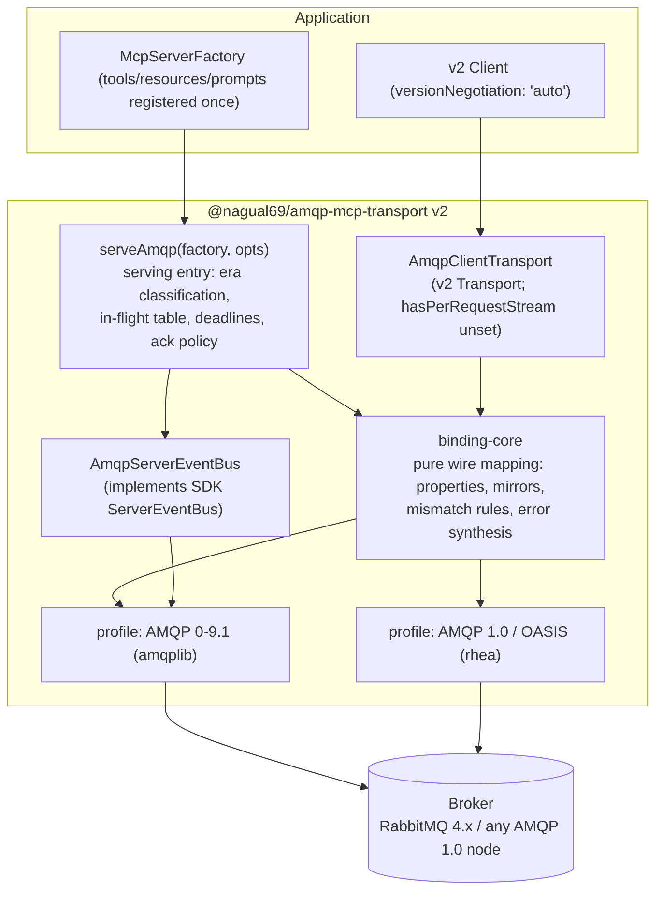
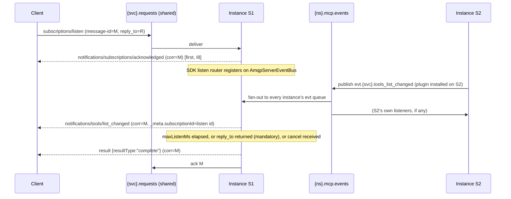

# Re-architecture plan: AMQP transport for MCP 2026-07-28

- **Status:** Proposed. Several items need a maintainer decision (§10). One of them supersedes
  clauses of a contract already ratified in `mcp_open_discovery_3_0` (§7).
- **Date:** 2026-10-22
- **Scope:** `AMQPConnectorforMCP` (this package, `amqp-mcp-transport`). It also covers the AMQP
  transport embedded in `mcp_open_discovery_3_0` (`src/transports/amqp/`) and how
  `AMQPConnectorforMCPEdge` (`@nagual69/amqp-mcp-edge`) fits in.
- **Inputs:**
  - A Grok conversation summarising the 2026-07-28 changes. It was treated as unverified, and every
    claim was re-checked against primary sources (§2.2).
  - The MCP 2026-07-28 specification pages.
  - The OASIS AMQP TC CSD01 drafts.
  - The published `@modelcontextprotocol/server` / `core` 2.3.1 type declarations.
  - The current source of all three repositories.

---

## 1. Executive summary

**The answer:** this package is not 2026-07-28 compliant, and patching it will not get there. The
re-architecture should:

1. Adopt the **OASIS "MCP over AMQP 1.0" binding model** as the normative semantics, and define a
   matching **AMQP 0-9.1 profile**. RabbitMQ over `amqplib` is the production path today.
2. Replace the single long-lived `Transport` object with a **serving entry**,
   `serveAmqp(factory, options)`. The 2026-era SDK has the same shape: `createMcpHandler` for HTTP
   and `serveStdio` for stdio. It runs **competing consumers on one shared durable request queue**,
   so any instance can answer any request.
3. Route **every server message about a request to that request's reply address**. That covers
   responses, progress, log messages and subscription streams. Broadcast survives only as a legacy
   compatibility path.
4. Implement the SDK's `ServerEventBus` over an AMQP topic exchange. `subscriptions/listen` then
   works across a horizontally scaled pool.
5. Solve **cancellation affinity** explicitly. The OASIS draft leaves it open. The fix is a control
   fan-out plus a request-identity header.
6. Serve both protocol eras from one endpoint. 2025-era traffic gets the stateless legacy path
   already in production in Open Discovery; 2026-era traffic gets the new binding.

**Fix first, regardless of this plan:**

- **The published v1 package has a live cross-client response leak.** It keys response routing by
  the client-chosen JSON-RPC `id`, so two clients that both send `id: 1` can receive each other's
  results.
- Open Discovery fixed this in its fork (`7ba522f`), but the fix never reached this package.
- This is a **P0 hotfix (Phase 0)**, independent of the spec work.
- **Status:** fixed in `amqp-mcp-transport@1.2.0`, which ports Open Discovery's whole AMQP transport into this package (see CHANGELOG).

**The main point of disagreement with the Grok analysis:** it is right about the direction but
wrong about where the work is.

- The SDK v2 `Transport` interface did *not* get meaningfully simpler. It still has `sessionId`
  and `setProtocolVersion`.
- What changed is the **serving model**: per-request server instances from a factory, a pluggable
  event bus, and era classification at the entry.
- A transport that only re-implements `Transport` against the v2 packages ends up as a 2025-era
  transport with new imports.

**On Open Discovery's ratified Option 3:** under 2026-07-28 it is half right.

- Right: AMQP never had the session the spec removed.
- Not right: the new **message patterns** do reach AMQP. These are request-scoped notifications,
  `subscriptions/listen`, per-request `logLevel`, and `server/discover`.
- Clauses §6.1 (one server per exchange) and §6.4 (broadcast notifications) contradict them.

---

## 2. What actually changed

### 2.1 Spec deltas that bear on a broker transport (verified)

All references are to `https://modelcontextprotocol.io/specification/2026-07-28/`.

| Change | Normative text (abridged) | Consequence for AMQP |
|---|---|---|
| Handshake and sessions removed | changelog: remove `initialize`/`notifications/initialized` and `Mcp-Session-Id`; `/basic/index`: servers MUST NOT rely on prior requests over the same connection | Any instance can serve any request. The one-endpoint-per-exchange model has no remaining justification. |
| Per-request `_meta` | `io.modelcontextprotocol/protocolVersion` and `…/clientCapabilities` are **required** on every request; `…/clientInfo` SHOULD; `…/logLevel` optional; missing required field → `-32602` | Version and capabilities travel with the message. The transport can mirror them for routing, but the body is authoritative. |
| `server/discover` | Servers MUST implement it. Result: `supportedVersions`, `capabilities`, `serverInfo` in `_meta`, `ttlMs`, `cacheScope` | Cheap and cacheable. It is also the era probe the v2 client uses in `versionNegotiation: 'auto'`. |
| Servers never initiate requests | `/basic/transports`: servers do not send JSON-RPC requests; sampling, elicitation and roots go via MRTR | The broken server→client request path in this package is deleted, not fixed. |
| MRTR | `InputRequiredResult {resultType:"input_required", inputRequests?, requestState?}`; retry is a **new request with a new id** carrying `inputResponses` + echoed `requestState`; only `tools/call`, `prompts/get` and `resources/read` may return it | A retry is uncorrelated and may land on any instance. `requestState` must be integrity-protected with a key **shared across the pool**. |
| `subscriptions/listen` | One long-lived request. The first message MUST be `notifications/subscriptions/acknowledged`. Every notification carries `_meta["io.modelcontextprotocol/subscriptionId"]` = the listen request's id | It needs a stream bound to one reply address and fed by change events from *every* instance. |
| Request-scoped notifications | Progress and `notifications/message` stay on the originating request's stream. Servers MUST NOT emit `notifications/message` for requests that omitted `logLevel` | Broadcasting progress or log messages to all AMQP clients is now non-conformant. It was always a cross-client data leak. |
| Cancellation | stdio: MUST send `notifications/cancelled {requestId}`; HTTP: closing the stream *is* the cancel | AMQP has no stream to close, so it uses the stdio rule (confirmed by OASIS §8). |
| Custom transports | MUST preserve JSON-RPC format, message patterns and the per-request metadata model; MUST deliver both directions; SHOULD document connection, framing and cancellation; MAY mirror body fields into the envelope, but "the body remains the source of truth; bindings that mirror metadata define how mismatches are rejected" | We must publish a binding document. Header mirroring is allowed, but the mismatch rule is our responsibility. |
| Tasks moved to an extension | `io.modelcontextprotocol/tasks` (SEP-2663): `CreateTaskResult {resultType:"task", taskId, pollIntervalMs}`, `tasks/get`, `tasks/update`, `tasks/cancel`, optional `notifications/tasks` via listen; `tasks/list` and blocking `tasks/result` removed | Task state must be queryable from any instance, so it belongs in a store, not a queue. The queue is for executing the work. |
| Cacheable results | `ttlMs` and `cacheScope` are **required** on list and read results. Requests carrying `inputResponses`/`requestState` MUST NOT be cached | Transport-neutral; the SDK fills them in. |
| Removed / deprecated | Removed: `ping`, `logging/setLevel`, `notifications/roots/list_changed`, `notifications/elicitation/complete`. Deprecated (removal ≥ 2027-07-28): roots, sampling, logging, DCR, HTTP+SSE | No AMQP keep-alive may be built on `ping`. Broker heartbeats already cover liveness. |
| Error codes | `-32020` HeaderMismatch, `-32021` MissingRequiredClientCapability, `-32022` UnsupportedProtocolVersion; resource-not-found moves to `-32602` | We reuse `-32020` for AMQP header/body mismatch (§5.8). |

Two inconsistencies in the spec itself affect us:

- **How a listen stream ends.**
  - `/basic/patterns/subscriptions`: the server **SHOULD** end a listen stream with a `complete`
    result.
  - `/basic/patterns/cancellation`: the server **MUST** send `notifications/cancelled` referencing
    the listen id when it tears the stream down.
  - OASIS §8 follows the former.
  - **We send the `complete` result, and treat an inbound `notifications/cancelled` for a listen id
    as equivalent.**
- **Server Cards (SEP-2127)** are an *Extensions Track* item, not core 2026-07-28. They are
  out of scope here.

### 2.2 Where the Grok analysis was wrong or incomplete

| Grok claim | Verified position |
|---|---|
| "Transport surface is still pluggable but simpler and request-oriented" | **Wrong in substance.** The v2 `Transport` (`@modelcontextprotocol/server` 2.3.1) still has `start/send/close`, `sessionId?` and `setProtocolVersion?`, and adds `setSupportedProtocolVersions?`, `hasPerRequestStream?`, and `requestSignal` / `onRequestStreamEnd` / `headers` on `TransportSendOptions`. The real change is the serving entries: `createMcpHandler(factory)` builds a fresh server per HTTP request; `serveStdio(factory, {transport})` pins one per connection. `ServerEventBus` is the seam for multi-process subscriptions. |
| Implied: v2 speaks 2026-07-28 by default | **Wrong.** Core `LATEST_PROTOCOL_VERSION` is still `"2025-11-25"`. The client's `versionNegotiation` defaults to `'legacy'`; `'auto'` probes with `server/discover`. A v2 client over AMQP is a 2025-era client unless configured otherwise. |
| "Cache hints (ttlMs/cacheScope) … transport can ignore them" | **Partly.** They are *required* fields, not hints. The transport can still ignore them. |
| "Mirror … like Streamable HTTP does with Mcp-Method / Mcp-Name" | **Partly.** Allowed, but OASIS defines **no** `application-properties` keys for MCP; its JSON-RPC binding only permits `subject` = `method`. Any `mcp-*` header we add is our extension, so its mismatch rule must be specified by us. |
| "correlationId + replyTo … still perfect. Keep." | **Needs a wire change.** OASIS correlates on the requester's **`message-id`**, which the responder echoes as `correlation-id` "unaltered in type or representation". Requests carry no `correlation-id`. Our v1 clients put a client-chosen `correlationId` on the request. The server accepts both during the transition (§5.9). |
| "Drop or greatly reduce sticky/session tracking" | **Dangerous if read literally.** The in-process mapping from (reply address, request id) to the in-flight exchange must stay. Deleting "session tracking" is exactly the half-migration Open Discovery's `AMQP_SESSION_MODEL.md` §2 warns about. Under per-request server instances the body-id collision goes away *inside the SDK*, but the transport's own in-flight table must never be keyed by the body `id`. |
| "Amazon MQ mcp-amqp-transport reference implementation" | **Misleading.** `@aws/mcp-amqp-transport` 1.0.2 is beta, published 2025-11-01, peers on SDK v1, targets the 2025 protocol and **rewrites JSON-RPC ids on the wire**. That violates OASIS §6.1 (body unchanged). Useful prior art for 0-9.1/1.0 dual support; not an interop target. |
| Cancellation "e.g., cancel notification or TTL + explicit cancel message" | **Under-specified.** OASIS §8 makes `notifications/cancelled` on timeout a client **MUST**. In SDK v2, `hasPerRequestStream` must stay unset or `false` for AMQP, otherwise the protocol layer suppresses `notifications/cancelled`. With competing consumers the cancel can land on the wrong instance; OASIS lists cancellation affinity as an open question. Grok did not mention this. |
| Not mentioned | Per-request `logLevel` with a MUST-NOT on unsolicited log messages; `requestState` integrity across a pool; mandatory `resultType`; `-32021` / `-32022`; resource-not-found renumbering; `ping` removal; the subscription-teardown inconsistency above. |

---

## 3. Current state

### 3.1 Three codebases, two forks of the same transport

| Codebase | What it is | 2026-07-28 posture |
|---|---|---|
| `AMQPConnectorforMCP` (this repo) | Published `amqp-mcp-transport` 1.0.0. Client + server `Transport` on `@modelcontextprotocol/sdk ^1.0.0` and `amqplib`. | README claims "fully compliant with 2025-11-25". Several of its defects (§3.2) predate the spec change. |
| `mcp_open_discovery_3_0/src/transports/amqp/` | A diverged, materially more correct fork: id rewrite, notification namespace split, broker-cancel handling, adapter-level recovery. Pinned by `test_amqp_extension_contract.js`. | Ratified 2026-08-19 as an "extension transport" with its own semantics (`docs/AMQP_SESSION_MODEL.md` §6). SDK pinned at v1 1.32.1. |
| `AMQPConnectorforMCPEdge` | `@nagual69/amqp-mcp-edge` 0.1.0. Versioned job / ack / progress / result envelopes, a DLX-backed job consumer, an event publisher with drain-wait backpressure. Explicitly *not* an MCP transport. | Orthogonal to the core spec. It is the natural execution backend for the Tasks extension (§5.10). |

Two forks that disagree on a security-relevant invariant is a worse risk than any single defect
below. Consolidating them is part of this plan.

**Consolidation update (1.2.0).** Open Discovery's transport and recovery runtime now live in this package, and the package is installable from GitHub. The remaining step is for Open Discovery to consume the package instead of its embedded copy (Phase 0b). After that, the 2026-07-28 rework happens once, here, and Open Discovery picks it up with a dependency bump. Porting changes back and forth between the repos is no longer needed.

### 3.2 Defect inventory: this package (v1.0.0)

These are measured from `src/transports/*.ts` at `3adeb98`.

| # | Defect | Where | Severity | Fate in v2 |
|---|---|---|---|---|
| D1 | Response routing keyed by the client-chosen JSON-RPC `id`. Concurrent clients that reuse ids overwrite each other's `{replyTo, correlationId}`, so responses go to the wrong client. | `amqp-server-transport.ts` `handleIncomingMessage` / `handleResponseMessage` (`routingInfoStore.set(jsonRpcMessage.id, …)`) | **Critical: confidentiality** | Hotfix in v1.0.1 (port OD `7ba522f`); structurally removed in v2 |
| D2 | The server binds `mcp.notification.#` and publishes its own notifications under the same namespace, so it consumes its own notifications. | `setupInfrastructure` / `handleNotificationMessage` | High | Hotfix (OD's `server-` / `client-notification` split); redesigned in v2 |
| D3 | Server-initiated requests are published under `mcp.request.#`, which loops back into the server's own queue. No client binds them. The README's "bidirectional" claim is false. | `handleRequestMessage` | High (dead feature) | Deleted; the spec forbids it |
| D4 | The client publishes JSON-RPC responses with routing key `mcp.response`, which nothing binds, so they are silently dropped. | client `sendResponse` | Medium | Deleted |
| D5 | Each server instance has its own exclusive queue bound to a topic exchange. N instances means N copies of every request and N answers. There are no competing consumers. | `setupInfrastructure` | High (no scale-out; duplicate side effects) | Replaced by a shared quorum request queue |
| D6 | The message is acked right after synchronous `onmessage` dispatch, before the handler runs. A crash loses in-flight work, and `prefetchCount` does not bound concurrency. | `handleIncomingMessage` → `safeAck` | Medium | Ack-on-completion with an idempotency policy (§5.7) |
| D7 | Invalid or oversize messages are `nack(requeue=false)` with no DLX and no error reply. The message is silently dropped and the client waits until timeout. | `safeNack` paths | Medium | DLX plus an error reply when addressable (OASIS JSON-RPC §6.5) |
| D8 | Client notifications bind `mcp.notification.#`. Every client receives every other client's and every server's notifications. | client `subscribeToNotifications` | High (cross-client leak) | Replaced by reply-address delivery |
| D9 | The client's response timeout only raises `onerror`. It neither cancels nor maps back to the JSON-RPC id. | client `setupRequestTimeout` | Low (the SDK times out on its own) | Timeout → `notifications/cancelled` (OASIS §8) |
| D10 | `publish()` return values are ignored, there are no publisher confirms, and `persistent: false` on durable exchanges. Silent loss under flow control. | all publish paths | Medium | Confirm channel plus drain-wait (reuse the Edge publisher logic) |
| D11 | A client reconnect creates a new anonymous reply queue, so in-flight responses addressed to the old queue are lost without a signal. | client `setupInfrastructure` | Low (now spec-sanctioned: the client times out and re-issues) | Documented behaviour |
| D12 | `@modelcontextprotocol/sdk ^1.0.0` floor is below the types it imports (`MessageExtraInfo`, `TransportSendOptions`). `author: "Your Name"`. Compliance claims in README, `docs/README.md` and `src/index.ts`. | `package.json`, docs | Low (hygiene) | Fixed in hotfix |

### 3.3 Open Discovery's ratified contract

`AMQP_SESSION_MODEL.md` is careful work and most of its reasoning survives. Its central finding
holds: `sessionId` never reaches the wire, so 2026-07-28 removes nothing AMQP had.

Its cost analysis of "Option 1, stateless per request" (§3) can now be answered point by point,
because the 2026-era protocol and SDK change the inputs:

| OD §3 objection to per-request serving | Under this plan |
|---|---|
| `notifications/cancelled` stops working, because the cancel lands on a fresh server running nothing | The cancel goes through a control fan-out to the instance that holds the in-flight exchange, which aborts that exchange's signal (§5.6.4). It no longer depends on a shared server. |
| `getClientCapabilities()` is empty without a prior `initialize` | In 2026-07-28 capabilities arrive in every request's `_meta`, and the SDK's modern path exposes them per request. For legacy-era traffic the behaviour is unchanged from today. |
| Factory replays 79 tool registrations per message, including notifications | Client notifications never construct a server; they go to the control plane. Per-request cost for requests is real and is gated by a benchmark in Phase 2 (§9, R2). OD's modern HTTP path pays the same cost under SDK v2 anyway. |
| Churns a live production path for symmetry | The churn is now forced by conformance, not symmetry. §6.4 broadcast violates request-scoped notification rules and the `logLevel` MUST NOT, and §6.1 forbids the scale-out the binding exists to enable. |

---

## 4. Design invariants

These are the properties every later section must preserve. Each one becomes a named test pin (§8).

1. **I1 — Body is authoritative.** The AMQP body is the unmodified JSON-RPC message (OASIS
   JSON-RPC §6.1). No id rewriting on the wire, ever.
2. **I2 — Correlation by request identity, never by body id.**
   - Every server message about a request goes to that request's reply address, with
     `correlation-id` set to the request's `message-id`.
   - The transport's in-flight table is keyed by `(principal, message-id)`. The client-chosen
     JSON-RPC `id` is never a key on any shared structure.
3. **I3 — No cross-client delivery in the modern era.** A message about request *R* reaches only
   *R*'s reply address. Broadcast exists only on the legacy compatibility namespace, behind a flag.
4. **I4 — Any instance, any request.** No request depends on state held by the instance that
   served a previous request. Cross-request state is carried by explicit client-passed identifiers
   (`requestState`, `taskId`, `subscriptionId`) and backed by shared stores or integrity-protected
   tokens.
5. **I5 — Bounded everything.** Every request carries a deadline. Every listen stream has a maximum
   lifetime. Every queue has size and TTL bounds. Every undeliverable message has an explicit fate:
   an error reply, a DLX, or both.
6. **I6 — Mirrors are checked.** Any envelope field that mirrors a body field is validated against
   the body. A mismatch is rejected (§5.8). It is never silently corrected.
7. **I7 — Principal comes from the broker.** Authorization decisions use a broker-validated
   identity, not a self-declared header.
8. **I8 — One reply link per request.** All messages for a request leave on the same channel or
   link, in protocol order (OASIS §9). The listen acknowledgement is always first.

---

## 5. Target architecture

### 5.1 Layering

- **`binding-core`** has no I/O. It maps JSON-RPC messages to and from an abstract
  `{body, properties, headers}` envelope and enforces I1, I2 and I6. Both profiles and every test
  pin target it first. This is where most of the correctness lives, and it can be unit-tested
  exhaustively without a broker.
- **Profiles** own connection, channel or link lifecycle, topology declaration, confirms,
  backpressure and recovery. 0-9.1 ships first; 1.0 follows (Phase 5).
- **`serveAmqp`** is deliberately named after `serveStdio` and `createMcpHandler`. It is a serving
  entry, not a `Transport`, because the 2026-era SDK puts era classification, instance lifecycle
  and listen routing at the entry.

### 5.2 Server serving model: three options

This is the largest architectural choice in the plan.

| | **A. Virtual connection per client** | **B. Bridge to `createMcpHandler`** | **C. Native AMQP serving entry** |
|---|---|---|---|
| Mechanism | One `serveStdio(factory, {transport})` per (instance × reply address), over an in-memory virtual `Transport` | Each AMQP request becomes an in-process web `Request` to `handler.fetch()`. The JSON or SSE response is relayed message by message to the reply address. The handler's `bus` is the AMQP event bus. | Our own per-request micro-transport and listen router over the SDK `Server`/`Protocol`, mirroring `PerRequestHTTPServerTransport` without HTTP |
| SDK owns era classification, listen ack-first, filtering, `subscriptionId` stamping | Yes | Yes | **No.** We re-implement them and track SDK changes. |
| Multi-instance subscriptions | Manual (no `bus` option on `serveStdio`) | Native (`bus` option) | Native (we implement it) |
| Instance cost | One pinned server per client per pool instance (N × clients, idle-evicted). The instance holds state across requests, which invites I4 violations. | One fresh server per request (the SDK-endorsed modern model) | One per request |
| HTTP coupling | None | **High.** We must synthesise `MCP-Protocol-Version`, `Mcp-Method`, `Mcp-Name` and **`Mcp-Param-*`**. The SDK handler rejects a missing `Mcp-Param-{Name}` for tools that declare `x-mcp-header` (verified in 2.3.1), so the bridge needs a tool-schema map refreshed on `tools_list_changed`. It must also parse SSE frames (set `keepAliveMs: 0`). | None |
| Delivery effort | M | **M** | L |
| Drift risk across SDK releases | Low | Medium (HTTP-rung changes leak in) | High (semantic re-implementation) |

**Recommendation:** B as the Phase 2 delivery vehicle, behind an internal `ServingEngine`
interface. Then C as the end state, once the SDK exposes a transport-neutral per-request entry.
Phase 2 includes filing that request upstream.

- **For B:** it inherits every SDK conformance fix and puts the multi-instance seam (`bus`) exactly
  where we need it.
- **The price of B:** paying HTTP-binding rules (`Mcp-Param-*`) that the AMQP binding does not
  require. That price is why B is not the end state.
- **A is rejected.** Memory scales with clients × instances, state pinned per client erodes I4, and
  it needs a hand-built cross-instance event path.

The Phase 2 spike has **go/no-go gates for B** (§9, R1–R3). If any gate fails, go straight to C.

### 5.3 Topology: AMQP 0-9.1 profile

`{ns}` is the namespace (today's `exchangeName`). `{svc}` is the logical server name; one name per
homogeneous pool.

| Object | Declaration | Purpose |
|---|---|---|
| `{ns}.mcp` | topic exchange, durable | All client→server traffic |
| `{ns}.{svc}.requests` | **quorum** queue, durable; `x-delivery-limit: 3`; `x-dead-letter-exchange: {ns}.mcp.dlx`; `x-max-length` + `overflow: reject-publish` | Shared request queue. Bound with `req.{svc}.#`. Every pool instance consumes it, as competing consumers. |
| `{ns}.{svc}.ctl.<instance>` | classic queue, exclusive, auto-delete | Per-instance control queue, bound with `ntf.{svc}.#`. **All client notifications fan out to every instance.** In 2026-07-28 that is essentially `notifications/cancelled`. |
| `{ns}.mcp.events` | topic exchange, durable | `AmqpServerEventBus` transport: `evt.{svc}.tools_list_changed`, `…prompts_list_changed`, `…resources_list_changed`, `…resource_updated` (URI in body) |
| `{ns}.{svc}.evt.<instance>` | exclusive, auto-delete | Per-instance event-bus queue, bound with `evt.{svc}.#` |
| `{ns}.mcp.dlx` + `{ns}.mcp.dead` | topic exchange + durable queue | Poison and invalid messages, with an `x-mcp-reject-reason` header |
| Reply address | **default:** RabbitMQ direct reply-to (`amq.rabbitmq.reply-to`); **option:** a client-declared exclusive queue | Per-client response and notification delivery |
| `{ns}.mcp.routing` (legacy) | existing v1/OD exchange, kept during the deprecation window | 2025-era clients unchanged: the shared request queue is *also* bound with `mcp.request.#` / `mcp.client-notification.#`, and legacy broadcast stays on `mcp.server-notification.*` |

Rationale for the non-obvious choices:

- **Quorum queue for requests.**
  - It is replicated, which v1's exclusive auto-delete queue was not: v1 lost every queued request
    when its single consumer died.
  - `x-delivery-limit` turns a poison message (one that crashes the handler) into a dead-letter
    after N attempts instead of an infinite redelivery loop.
  - **Message TTL comes from the request deadline**, per message, via `expiration` (§5.7). It is
    not a queue-wide `x-message-ttl`.
- **Direct reply-to as the default reply address.**
  - It needs no queue declaration per client and has the lowest latency.
  - Its semantics match the spec exactly: if the client's channel dies, replies cannot be
    delivered, and the client re-issues. 2026-07-28 removed resumability for the same reason.
  - **Undeliverable-reply detection (needs verification).** The server should learn when a reply
    address is gone, so it can abort the request or end the listen stream, per OASIS JSON-RPC §9
    ("SHOULD stop processing").
    - With a **named exclusive reply queue**, this is certain: a `mandatory: true` publish to a
      deleted queue via the default exchange is unroutable and comes back as `basic.return`.
    - With **direct reply-to**, whether a stale pseudo-queue produces a return or a silent discard
      must be verified against RabbitMQ 4.x in the Phase 2 spike.
    - If it is a silent discard, direct reply-to keeps its latency advantage for plain requests.
      Listen streams then rely on `maxListenMs` alone, or the client opts into a named reply queue
      for listens.
  - Constraint: the client must consume direct reply-to in no-ack mode on the publishing channel.
  - A named exclusive queue stays available for clients that need replies to outlive a channel
    without outliving the connection.
- **Client notifications fan out; requests compete.** This is the cancellation-affinity solution
  (§5.6.4). The cost is O(instances) per cancel, which is negligible against request volume.
- **One logical server name per homogeneous pool.**
  - `tools/list` from any instance must return the same set (I4).
  - **Per-tool sharding by routing key is possible, but it is not the default.** If `nmap_*` calls
    route to a network-zone pool, the pool that answers `tools/list` must still advertise them. That
    means either a gateway that aggregates, or registering remote-executed tools whose handlers
    dispatch to the zone. The second is the Edge library's job model (§5.10).

### 5.4 Wire mapping

Each row gives the 0-9.1 property or header, then the 1.0 field (OASIS), for every message kind.

| Field | Client→server request | Client→server notification | Server→client response / notification |
|---|---|---|---|
| Body | JSON-RPC object, UTF-8, unmodified | same | same |
| `content_type` / `content-type` | `application/json` | same | same |
| `message_id` / `message-id` | **MUST**, globally unique (UUID) | **MUST** | **MUST** (new per message) |
| `reply_to` / `reply-to` | **MUST** | **MUST NOT** (OASIS) | absent |
| `correlation_id` / `correlation-id` | absent (v1 clients set it; see §5.9) | absent | **MUST** = the request's `message-id`, byte-identical |
| `expiration` (0-9.1) / `ttl` header (1.0) | remaining deadline in ms | — | listen: remaining stream lifetime |
| `user_id` (0-9.1) | **MUST** be set. The broker validates it against the authenticated user (RabbitMQ rejects a mismatch). | **MUST** | set by server |
| routing key (0-9.1) / `subject` (1.0) | `req.{svc}.{method}` with `/`→`.` / `subject` = `method` | `ntf.{svc}.{method}` / `subject` = `method` | default exchange, key = reply address / absent |
| header `mcp-protocol-version` | mirror of `_meta[…/protocolVersion]` | mirror if present | — |
| header `mcp-method` | mirror of `method` | mirror | — |
| header `mcp-name` | mirror of `params.name` / `params.uri` for `tools/call`, `prompts/get`, `resources/read` | — | — |
| header `mcp-request-message-id` | — | on `notifications/cancelled`: the cancelled request's `message-id` (§5.6.4) | — |
| header `traceparent` / `tracestate` | mirror of the `_meta` OpenTelemetry keys | mirror | propagated |
| `mandatory` (0-9.1 publish flag) | `true` (an unroutable request is a deployment error and must surface) | `true` | **`true`** (a returned reply aborts the request) |
| delivery mode | persistent | transient | transient |

The `mcp-*` headers are **our extension**: OASIS defines no `application-properties` for MCP. They
are advisory for routing and observability, and they are **checked** (I6, §5.8). On the 1.0 profile
they become `application-properties` with the same names.

### 5.5 Client transport

The client is `AmqpClientTransport implements Transport` (v2 core types).

- `hasPerRequestStream` is **left unset**. The SDK then emits `notifications/cancelled` on abort or
  timeout, as OASIS §8 requires.
- `send(request)`:
  - mint `message-id`;
  - record `pending[message-id] = {id, deadline}`;
  - publish with `reply_to`, mirrors and `expiration`.
- `send(notifications/cancelled)`: look up the cancelled request's `message-id` by body
  `requestId`, then attach `mcp-request-message-id`.
- Reply consumer: hand the body to `onmessage` untouched. The SDK correlates by body `id`, which is
  unique *within this client* by construction. `pending` exists only for deadline bookkeeping and
  cancel lookups.
- `sessionId` stays `undefined`. `setProtocolVersion` / `setSupportedProtocolVersions` are stored
  only to fill the `mcp-protocol-version` mirror for legacy-era messages that lack `_meta`.
- Document `versionNegotiation: 'auto'` as the recommended client setting. Make it the default in
  the convenience constructor `connectAmqpClient()`.

### 5.6 Message patterns

#### 5.6.1 Request / response and request-scoped notifications

1. A request is consumed from the shared queue.
2. It is validated, and its mirrors are checked against the body.
3. An exchange record `X = {principal, messageId, replyTo, deadline, abort}` is created.
4. The request is dispatched through the serving engine.
5. Every message the SDK emits for that exchange (progress, `notifications/message` when `logLevel`
   was supplied, then the result) is published on **one confirm channel**, in order. Each goes to
   `replyTo` with `correlation_id = messageId` (I2, I8).
6. The request is acked when the terminal response is broker-confirmed (§5.7).

#### 5.6.2 MRTR

The transport needs no special machinery. `InputRequiredResult` is an ordinary terminal response,
and the retry is a new request (new id, new `message-id`) that may land on any instance.

- **Pool requirement:** `requestState` is produced and verified with the SDK's
  `createRequestStateCodec`, using a **shared HMAC key distributed to every instance**.
- It is bound to the principal and the originating method/name, with a TTL. The spec says servers
  SHOULD bind it to these.
- A per-instance random key breaks MRTR the moment a retry lands elsewhere. This is the easiest way
  to make the pool *look* like it works in single-instance tests and fail in production. It gets a
  dedicated multi-instance pin.

#### 5.6.3 `subscriptions/listen`

- **`AmqpServerEventBus.publish` goes only to the broker**, including events destined for the local
  instance. Delivery always comes back through the instance's own event queue. This gives one path,
  one ordering and no double delivery. It also trivially satisfies the bus contract's "MUST NOT
  echo back to the listener that published".
- **Lifetime.** OASIS §8 requires the server to bound each stream's lifetime but fixes no value.
  `maxListenMs` defaults to 15 minutes, which is this binding's choice. On expiry the server
  sends a `complete` result and the client re-listens.
- **Dead-client detection.** It is free with `mandatory` replies to a named reply queue: the first
  undeliverable notification ends the stream. On direct reply-to it is subject to the §5.3
  verification. If no events occur at all, the stream is bounded by `maxListenMs` in every case.
- **Ack timing for listen.** The listen request is acked at **acknowledgement time**, not at stream
  end. Holding an unacked delivery for 15 minutes would pin a prefetch slot and, on instance crash,
  redeliver the listen to another instance. That redelivery is a *feature* in principle, but the
  client cannot distinguish it from a duplicate ack. The client re-listens on stream loss instead.
  The ack bookkeeping stays simpler and the semantics stay explicit.
- **Event-bus durability.** The event queues are non-durable on purpose. A missed `list_changed`
  self-heals at the next `tools/list`, because the `ttlMs` cache bound caps staleness.
- **`resource_updated` filtering** stays in the SDK router. The bus carries all events for `{svc}`.
  If URI fan-out volume ever matters, switch to a hash-sharded routing key (`evt.{svc}.res.<hash>`).
  Not needed now.

#### 5.6.4 Cancellation: the affinity solution

The problem: with competing consumers, `notifications/cancelled` lands on an arbitrary instance.
OASIS JSON-RPC §9 calls this best-effort and lists an affinity mechanism as an open question.

How the solution works:

1. The client publishes the cancel under `ntf.{svc}.notifications.cancelled`. This **fans out to
   every instance's control queue** (§5.3).
2. It carries the header `mcp-request-message-id`, the cancelled request's `message-id`, which is
   globally unique and unguessable.
3. Each instance looks up its in-flight table by `(principal, message-id)`. If the header is
   absent, as from an OASIS-only client, it falls back to `(principal, body requestId)`. On a hit
   it aborts that exchange's signal, and the SDK aborts the per-request instance.
4. **Pre-dispatch cancellation.** The instance also records the cancel in a short-lived "cancelled"
   set, kept for the deadline window. A request consumed after its cancel arrived is dropped with no
   reply, since the client has already given up. Per-message `expiration` covers the rest.
5. **Authorization.** A cancel only matches exchanges whose principal equals the cancel's
   broker-validated `user_id` (I7). Client A cannot cancel client B's `id: 1`. This preserves the
   invariant behind OD's leak pin, for cancels.

### 5.7 Delivery semantics

These are the policies v1 left undefined (D6, D7, D10).

- **Deadline propagation.**
  - The client sets `expiration`. The broker discards stale requests before dispatch.
  - The server derives the exchange deadline from it and aborts at expiry.
  - A request consumed with less than `minUsefulMs` remaining is dropped.
- **Ack on completion, at-most-once execution for side effects.**
  - Requests are acked only after the terminal response is publisher-confirmed. Prefetch therefore
    becomes a real concurrency bound, and a crash redelivers.
  - On a delivery with `redelivered = true`:
    - Non-tool methods, and `tools/call` for tools annotated `readOnlyHint: true` or
      `idempotentHint: true`, are **re-executed**.
    - Any other `tools/call` is **answered with an error** (`-32603`,
      `data: {reason: "redelivered-non-idempotent"}`) instead of re-running a side effect that may
      have half-happened.
  - This uses MCP's own tool annotations as the idempotency contract. It is the strongest policy
    available without a distributed dedup store.
  - Optional: a `message-id` dedup LRU per instance, per the OASIS JSON-RPC §8 SHOULD, for
    same-instance redelivery.
- **Invalid input.** Not JSON, not JSON-RPC, over size, or a mirror mismatch.
  - If `message_id` and `reply_to` are present, send the JSON-RPC error to the reply address, with
    `id: null` if the body id is unreadable (OASIS JSON-RPC §6.5).
  - Then **dead-letter** the message with a reason header.
  - v1's silent drop is gone.
- **Backpressure.**
  - Replies and events go over a confirm channel.
  - A `false` from `publish` waits for `drain`, with a timeout. Port `EdgeEventPublisher`'s
    drain-wait.
  - The request queue uses `overflow: reject-publish`, so clients get a `basic.nack` rather than
    unbounded queue growth.
- **Recovery.**
  - Connection loss: in-flight exchanges are aborted and their deliveries unacked, so the broker
    redelivers under the policy above.
  - Listen streams on that instance end without a `complete` result. The client sees the reply
    stream go quiet, or its reply channel close, and re-listens.

### 5.8 Security

- **Principal.**
  - Broker authentication: SASL PLAIN over TLS, SASL EXTERNAL with mTLS, or RabbitMQ's OAuth 2.0
    plugin with a JWT as password.
  - **`user_id` MUST be set on every message.** RabbitMQ validates it against the connection's
    user, so it is a trustworthy per-message principal.
  - The serving entry passes it into the SDK as `authInfo`, so OD's scope enforcement keeps working
    on AMQP.
  - **Bearer tokens in AMQP headers are not supported by default.** They would be persisted in
    queues, DLXs and broker traces. End-user delegation over AMQP needs its own design and is out
    of scope.
- **Mirror mismatch (I6).**
  - If any `mcp-*` header disagrees with the body, the response is a `-32020` HeaderMismatch error.
  - This is the defence against routing-header spoofing. Example: a message routed by header to a
    privileged pool while its body calls a different tool.
  - **Broker-side routing on headers is only safe because the consumer re-validates.**
- **Isolation.** I2 and I3 replace v1's broadcast and shared notification bindings (D2, D8). The
  only cross-client channel left is the legacy broadcast namespace, which carries no request-scoped
  content.
- **Shared secrets.** The `requestState` HMAC key, and any task-store credentials, are pool-wide
  secrets. Rotation uses key ids, matching the codec's verification path.
- **Size limits.** `maxMessageSize` (default 1 MiB, unchanged) is enforced at consume, and
  `max-message-size` at attach on the 1.0 profile.

### 5.9 Dual-era serving

Each message is classified in this order:

1. `_meta["io.modelcontextprotocol/protocolVersion"]` present → **modern**.
2. `initialize`, `notifications/initialized`, or claim-less → **legacy**.

| Era | Serving | Notifications | Reply correlation |
|---|---|---|---|
| Modern (2026-07-28) | Per-request instance (§5.2 B/C) | Reply address only (I3) | `correlation_id` = request `message_id` |
| Legacy (2025-11-25) | Stateless legacy fallback: each request served independently. This is **exactly OD contract §6.3 as ratified**, so legacy clients see no behaviour change. | `*/list_changed` translated from the event bus onto the legacy broadcast namespace `mcp.server-notification.*`; progress and log messages to the reply address (the leak fix, applied to legacy too) | v1 clients send `correlationId` on the request with no `message_id`. The server echoes that `correlationId`. |

**The legacy path is deprecated at v2.0 and removed at v3.0.** That is no earlier than the first
spec revision that drops 2025-era support. Removal is a flag flip
(`legacy: 'serve' | 'reject'`, the same vocabulary as `serveStdio`).

### 5.10 Tasks extension and the Edge library

The Tasks extension needs three things AMQP is good at, and one it is not:

- **Good fit:** durable execution of long work, retry with dead-lettering, and progress fan-in.
- **Poor fit:** point lookup of task state by `taskId` for `tasks/get`. A queue cannot answer
  "what is the status of X". The task store must be a KV or relational store that **every pool
  instance shares**, so that any instance can answer `tasks/get` (I4).
  - OD's stores today are per-process `better-sqlite3` files, which do not qualify.
  - A single-instance OD can use them.
  - A pool needs Postgres or an equivalent (see R-OD below).

The convergence with `@nagual69/amqp-mcp-edge`:

| Tasks extension | Edge contract (exists today) |
|---|---|
| `tools/call` → `CreateTaskResult {taskId}` | control plane publishes `execution.job {jobId = taskId, idempotencyKey, timeoutMs}` |
| status `working` | `execution.ack` / `execution.progress {state}` → task store |
| `completed` / `failed` | `execution.result` / `execution.failure {retryable}` → task store |
| `tasks/cancel` | (new) `execution.cancel` job-control message |
| `notifications/tasks` via listen | task-store write → `AmqpServerEventBus` → listen router |
| `input_required` | (new) `execution.input_required` → MRTR-style resume via `tasks/update` |

So Edge stays MCP-agnostic, as its README insists, and gains two envelope types. The task
orchestration (store, state machine, bus publication) lives in this package as an optional
`tasks` module. Edge's existing `idempotencyKey` and attempt metadata are what make at-least-once
job delivery safe. That is the property §5.7 could only approximate for synchronous calls.

### 5.11 Observability

- Mirror the `traceparent` / `tracestate` `_meta` keys into headers on every hop. Broker tooling and
  OpenTelemetry instrumentation can then stitch client → queue → instance → reply without parsing
  bodies.
- Emit structured events with these fields:
  - `message_id`, `correlation_id`, `svc`, `method`, `name`, `era`;
  - `outcome` (`complete | input_required | task | error | cancelled | expired | returned |
    dead-lettered`);
  - `queue_wait_ms` (from `timestamp`), `service_ms`.
- `getAmqpStatus()` gains per-instance in-flight counts, open listen streams, and DLX rate.

---

## 6. Package and repository shape

- **Package.**
  - Rename to `@nagual69/amqp-mcp-transport@2.0.0`, matching the Edge scope.
  - Keep a final `amqp-mcp-transport@1.0.x` line for the hotfix and a deprecation notice.
  - Fix `author` and the license header. This package is Apache-2.0, Edge is MIT; decide whether to
    align (§10).
- **Entry points:**
  - `.`: `serveAmqp`, `AmqpClientTransport`, `connectAmqpClient`.
  - `./bus`: `AmqpServerEventBus`.
  - `./binding`: pure mapping and validation, for third-party implementers and tests.
  - `./tasks`: optional.
  - `./testing`: an in-memory broker double in the style of Edge's `mock-edge-channel`.
- **Peer dependencies:** `@modelcontextprotocol/server` and `@modelcontextprotocol/client` `^2.3`,
  `@modelcontextprotocol/core` `^2.3`.
- **Optional peer dependencies:** `amqplib` (0-9.1 profile), `rhea` (1.0 profile).
- **Node:** ≥ 20. The v2 SDK packages declare `engines.node >=20`, and engine B relies on
  web-standard `Request`/`Response`.
- **Docs:** `docs/BINDING.md` is the normative binding document the spec says custom transports
  SHOULD publish. It holds the §5.3–§5.9 content in normative form, with RFC 2119 keywords and
  conformance clauses like OASIS §11.

---

## 7. Impact on Open Discovery's ratified contract

Clause by clause against `mcp_open_discovery_3_0/docs/AMQP_SESSION_MODEL.md` §6. Changing a
ratified clause needs a superseding ADR in that repo, ratified by the maintainer. This plan
proposes the ADR; it does not edit that document.

| §6 clause | Verdict | Reason |
|---|---|---|
| 6.1 Endpoint, not session; one server per exchange | **Supersede** | The 2026-07-28 statelessness plus OASIS §4/§7 ("any Server instance can serve any request") make competing consumers the normative deployment. The exclusive per-instance queue is D5. |
| 6.2 Per-request correlation | **Keep and strengthen** | Correlation moves to `message-id` → `correlation-id`. The in-flight table is keyed by `(principal, message-id)`. The leak guard is rewritten to the new shape and **must still prove two concurrent clients with `id: 1` each get only their own response** (§8, pin P1). |
| 6.3 No protocol session; `initialize` gates nothing | **Keep. It is now spec-native.** | Legacy-era behaviour is unchanged; the modern era never sends `initialize`. |
| 6.4 Notifications are broadcast | **Supersede for modern; restrict for legacy** | Request-scoped progress and log messages go to the requester only. Sending `notifications/message` without a per-request `logLevel` is a spec MUST NOT. Legacy keeps broadcast for `*/list_changed` only. |
| 6.5 No server-initiated requests | **Keep. It is now spec-native.** | Sampling and elicitation return via MRTR with no transport change. The capability OD declared absent becomes available. |
| 6.6 Delivery bounds | **Amend** | Drops become dead-letter plus an error reply when addressable. Per-message deadlines replace the queue-wide 1 h TTL. "In-flight requests are never answered on recovery" becomes "redelivered under the §5.7 idempotency policy". |

The pinning discipline OD built is the right instinct and carries over:

- named assertions;
- structure-not-prose checks;
- mutation-verified pins.

The new pins (§8) should be authored in that style, and OD's `test_amqp_extension_contract.js`
should be **replaced, not deleted** (OD §2's own rule).

---

## 8. Test and conformance strategy

| Pin | Invariant | Level |
|---|---|---|
| P1 | Two clients, concurrent `tools/call` with `id: 1`, on one instance *and* across two instances; each receives exactly one response at its own reply address | binding-core unit + broker integration |
| P2 | Body is byte-identical end to end; no id appears on the wire that the client did not send (I1) | unit |
| P3 | `correlation-id` equals the request `message-id` exactly; no response is published without it (I2) | unit |
| P4 | Progress and log messages for request R reach only R's reply address; no log message without `logLevel` (I3) | unit + integration |
| P5 | Two instances on one `{svc}`: each request is answered exactly once (the old §6.1 double-answer, now testable and inverted) | integration (2 processes) |
| P6 | Listen: acknowledgement is first; a change event published on instance S2 reaches a stream held by S1; a returned reply ends the stream; `maxListenMs` ends it with `complete` (I8) | integration |
| P7 | A cancel from principal A never aborts principal B's exchange with the same body id; the `mcp-request-message-id` path hits; the body-id fallback hits for the same principal only | unit |
| P8 | Header/body mismatch on any mirrored field → `-32020` and dead-letter; never dispatched (I6) | unit |
| P9 | A redelivered non-idempotent `tools/call` is refused; a redelivered `readOnlyHint` call re-executes | integration (kill an instance mid-call) |
| P10 | An MRTR retry served by a different instance verifies `requestState`; a per-instance key fails this test (guards the shared-key requirement) | integration |
| P11 | A request past its deadline is not dispatched; an unaddressable invalid message is dead-lettered with a reason | unit + integration |
| P12 | Legacy era: a v1 client (`correlationId` on request, `initialize` first) passes the existing OD smoke flow unchanged | integration |

CI changes:

- RabbitMQ **4.x** in the service container. The current workflow uses `rabbitmq:3-management`
  with `rabbitmqctl node_health_check`, which is deprecated; use `rabbitmq-diagnostics -q ping` or
  `check_running`.
- A two-instance job for P5, P6, P9 and P10.
- Later, an AMQP 1.0 job against RabbitMQ's native 1.0 support, plus a second broker or router for
  the "routed" topology OASIS names.

---

## 9. Phased delivery

Effort is relative sizing (S < M < L) for a single maintainer. It is not a calendar commitment.

| Phase | Content | Exit criteria | Size |
|---|---|---|---|
| **0 — Consolidate into this package** | **Done in 1.2.0.** OD's transport, recovery runtime and contract pins are ported here (D1, D2, D8 fixed). Packaging is fixed so `npm install github:nagual69/AMQPConnectorforMCP#v1.2.0` builds. The false compliance claims are removed. | P1 (single-instance form) passes; README states the 2025-era scope honestly | S |
| **0b — OD consumes the package** | OD replaces `src/transports/amqp/` with a git dependency on this package and keeps `startAmqpTransport` as a thin wrapper. It re-points its AMQP suites at the package. `test_amqp_extension_contract.js` reads the transport source and OD's contract doc by path, so those pins move to this repo's `contract.test.ts` (already ported). | OD's AMQP suites green against the package; no embedded fork remains | S–M |
| **0b — OASIS review (deadline 18 Nov 2026 23:59 UTC)** | Submit the §11 comments through the OASIS comment facility (not GitHub). | Comments filed | S |
| **1 — Binding document + ADR** | `docs/BINDING.md` (normative; 0-9.1 profile plus mapping to OASIS 1.0). Superseding ADR drafted in OD for §6.1 / §6.4 / §6.6. | Maintainer ratifies the ADR (decision D-1) | M |
| **2 — v2 core on 0-9.1** | `binding-core`; `AmqpClientTransport`; `serveAmqp` with engine B; `AmqpServerEventBus`; quorum topology; delivery policy; legacy era path. **Spike gates for engine B:** R1 per-request factory p99 with OD's full plugin set ≤ budget agreed in D-3; R2 `Mcp-Param-*` synthesis correct across dynamic tool changes; R3 SSE relay preserves order and terminality. Upstream SDK issue for a transport-neutral per-request entry. | P1–P12 green on RabbitMQ 4.x, two-instance CI | L |
| **3 — OD adopts v2** | OD migrates to SDK v2 (a prerequisite it needs for HTTP anyway). It bumps the package dependency to v2 and runs the legacy era for existing clients, including the VS Code AMQP bridge. OD runs as a single instance (D-8). | OD green on v2 of the package | M |
| **4 — Tasks** | Optional `tasks` module; task store adapter; two new Edge envelope types; listen-fed `notifications/tasks`. | Long-running OD tool (e.g. a full nmap sweep) runs as a task across an instance restart | M |
| **5 — AMQP 1.0 profile** | `rhea` profile conforming to OASIS CSD01 (or its successor), including dynamic temporary reply nodes; interop test against an independent 1.0 implementation if one exists by then. | OASIS §11 client and server conformance clauses satisfied | M |
| **6 — Engine C** | Native serving entry replaces the HTTP bridge, once the SDK exposes the needed seam or the bridge's coupling cost is proven. | Engine swap with P1–P12 unchanged | M–L |

Sequencing rationale:

- Phase 0 is first because it is a live confidentiality defect in a published package.
- Phase 0b is time-boxed by an external deadline 27 days out, and it is the cheapest point at which
  to influence the standard we will conform to.
- Phase 1 precedes code because the spec makes a published binding document a SHOULD for custom
  transports, and because OD's history shows the contract is what prevents half-migrations.

---

## 10. Decisions required from the maintainer

| # | Decision | Options | Recommendation |
|---|---|---|---|
| D-1 | Supersede OD contract §6.1 / §6.4 / §6.6 | Ratify the superseding ADR / keep Option 3 as-is and confine v2 to non-OD users | **Ratified 2026-10-28** (Open Discovery `docs/adr/ADR-amqp-2026-07-28-contract.md`). Keeping §6.4 would have made OD's AMQP path non-conformant for every 2026-era client. Keeping §6.1 would have forfeited AMQP's main advantage. D-8 (single instance) was ratified with it. |
| D-2 | Serving engine | A / B→C / C directly | **B → C**, gated by the Phase 2 spike |
| D-3 | Per-request factory budget for OD | e.g. p99 ≤ 5 ms / ≤ 20 ms / measure first | Measure first. If it fails, invest in registration cost (`preloadSchemas`, precompiled schemas) before abandoning per-request instances. |
| D-4 | AMQP 1.0 priority | Phase 5 as planned / pull forward / never | **As planned.** RabbitMQ is the production broker; 1.0 matters for standard conformance and non-RabbitMQ brokers, not for OD today. |
| D-5 | Legacy-era retention | Until v3.0 / fixed date / until the VS Code bridge migrates | Until the VS Code bridge and any other known v1 client migrate, and no earlier than v3.0 |
| D-6 | Package name and licence | `@nagual69/amqp-mcp-transport` Apache-2.0 / MIT to match Edge | Rename. Licence is the maintainer's call; Apache-2.0's patent grant matters more for a transport others embed. |
| D-7 | Reply-address default | Direct reply-to / exclusive named queue | **Direct reply-to for requests**, because its failure semantics match the spec's no-resumability stance. For listen streams, use a named exclusive queue unless the §5.3 return-on-stale verification passes. |
| D-8 | OD scale-out | Run OD as one instance on the new binding / move OD's shared state (plugin registry, credentials, memory, tasks) to Postgres and run a pool | **Ratified 2026-10-28 with D-1: one instance.** The binding is conformant with N = 1, and the migration of shared state is a separate project with its own risk (R-OD). |

---

## 11. Proposed OASIS CSD01 comments

These come from building against both CSD01 drafts. They were re-checked against the CSD01 text
and the MCP 2026-07-28 pages on 2026-10-22, and the list below is that checked version. The
deadline is 18 Nov 2026 23:59 UTC, through the OASIS comment facility only (comment sign-up and the
OASIS Feedback License first; not GitHub).

1. **Cancellation affinity (JSON-RPC §9, Appendix 4; MCP-AMQP §8).**
   - Propose an optional `application-properties` key on `notifications/cancelled` carrying the
     cancelled request's `message-id`.
   - It cannot be `correlation-id`, which §6.2 Table I forbids on requester-sent notifications.
   - Because `message-id` is globally unique, a fan-out of cancels to every responder instance
     becomes exact.
   - The key is set by the sender, so §11.1 still applies: act only on a cancel from the request's
     own authenticated principal. Cite the cross-client hazard of matching on the body `requestId`
     alone.
2. **Server-initiated teardown of a subscription stream is underspecified (MCP-AMQP §8).**
   - MCP's `/basic/patterns/cancellation` says a server MUST send `notifications/cancelled` for the
     listen id when it tears a stream down. `/basic/patterns/subscriptions` says it SHOULD send a
     `complete` result.
   - These are not contradictory, since both can be sent. But MCP-AMQP §8 mentions only the result.
   - Ask the binding to reference both messages, put them on the same Reply Link, define their
     order, and say which one ends the stream.
   - Also ask it to say that a Client ends a stream voluntarily with `notifications/cancelled`.
3. **Undeliverable reply detection (JSON-RPC §7, §9; MCP-AMQP §8).**
   - Ask for a non-normative list of what "learns that it cannot deliver" looks like: a refused
     sender attach (`amqp:not-found`), a reply link detached with an error, or a delivery settled
     `rejected` (or repeatedly `released`).
   - This is distinct from the Appendix 4 "Failure signalling" question, which is about the
     requester.
4. **Mismatch handling for mirrored fields, and error-code allocation (JSON-RPC §6.2, §10, §11.1,
   Appendix 4; MCP-AMQP §6).**
   - MCP requires a binding that mirrors body fields to define how mismatches are rejected.
     MCP-AMQP inherits `subject` = `method` but defines no rejection.
   - Ask for: reject with a JSON-RPC error and do not dispatch.
   - Separately, the "Failure signalling" question proposes codes from -32000 to -32099. MCP
     2026-07-28 reserves -32020 to -32099 for itself (-32020 `HeaderMismatch` is specified for HTTP
     headers). So the binding should stay out of that band, or the code should be agreed with the
     MCP maintainers.
5. **Request authorization needs a container-validated principal (JSON-RPC §1, §11.1; MCP-AMQP §1,
   §10.1).**
   - Both drafts address reply-path authorization, not request authorization. MCP servers decide
     authorization per tool.
   - Ask for non-normative guidance: take those decisions from an identity the container has
     authenticated, such as AMQP 1.0 `properties.user-id` validated against the connection, or the
     SASL identity on a direct link. Never take them from sender-set application properties.
   - Add the caveat that a routed topology may not preserve that identity.

**Withdrawn from the earlier draft:** an informative AMQP 0-9.1 annex.
- The TC's work products are AMQP 1.0.
- RabbitMQ 4.x speaks AMQP 1.0 natively.
- The claim that most MCP brokers use 0-9.1 was unsubstantiated.

The 0-9.1 profile belongs in this package's own `BINDING.md`.

---

## 12. Risks

| Risk | Likelihood | Impact | Mitigation |
|---|---|---|---|
| SDK v2 churn (2.0.0 → 2.3.1 in ~10 weeks), especially in HTTP-rung internals engine B depends on | High | Medium | Pin a minor range. Keep the engine behind an interface. P1–P12 run against every SDK bump. Engine C is the exit. |
| OASIS CSD01 changes during review | Medium | Low–Medium | 0-9.1 ships first. 1.0 conformance is Phase 5, after CSD02 or CS. Comments filed in Phase 0b shape the change. |
| Per-request instance cost too high for OD's plugin set | Medium | Medium | D-3 benchmark gate. Registration-cost work before architectural retreat. |
| At-least-once redelivery re-runs a side effect | Low (policy refuses non-idempotent redelivery) | High | §5.7 policy. Tasks with `idempotencyKey` for anything long or dangerous. |
| Shared `requestState` key mismanaged (per-instance or unrotated) | Medium | Medium (MRTR fails across instances) | P10 makes the misconfiguration fail CI. Key-id rotation. |
| Legacy clients depend on v1 quirks beyond OD §6 (e.g. the client receiving all notifications, D8) | Medium | Low | Legacy-era integration pin P12. Inventory known clients (VS Code bridge) before Phase 3. |
| RabbitMQ version floor (quorum `x-delivery-limit` semantics, native AMQP 1.0, direct reply-to return behaviour) | Low | Low | Document a RabbitMQ ≥ 4.0 floor for v2 and verify the exact feature list in Phase 2 before publishing it. |
| **R-OD:** OD cannot actually run as a competing-consumer pool. Plugin registry, credentials, memory/CMDB and any task store are per-process SQLite, so instances would disagree on `tools/list` and state, violating I4. | High if a pool is attempted | High | D-8: run OD as a single instance on the v2 binding. A pool waits on moving shared state to Postgres. The v2 package itself carries no such constraint. |

---

## 13. Sources

- MCP 2026-07-28: `/changelog`, `/basic/index`, `/basic/versioning`, `/basic/transports`,
  `/basic/transports/stdio`, `/basic/transports/streamable-http`, `/basic/patterns/mrtr`,
  `/basic/patterns/subscriptions`, `/basic/patterns/cancellation`, `/server/discover`,
  `/server/utilities/caching`, `/server/utilities/logging`, `/deprecated`, `/schema`; extension
  `https://modelcontextprotocol.io/extensions/tasks/overview`.
- OASIS AMQP TC, CSD01 (15 Oct 2026), public review until 18 Nov 2026:
  - `https://docs.oasis-open.org/amqp/mcp-amqp/v1.0/csd01/mcp-amqp-v1.0-csd01.md`
  - `https://docs.oasis-open.org/amqp/jsonrpc-amqp/v1.0/csd01/jsonrpc-amqp-v1.0-csd01.md`
  - announcement: `https://www.oasis-open.org/2026/10/20/invitation-to-comment-on-json-rpc-2-0-over-amqp-1-0-and-mcp-over-amqp-1-0-csd01-ends-18-nov/`
- `@modelcontextprotocol/server` and `@modelcontextprotocol/core` 2.3.1 published type declarations:
  `Transport`, `TransportSendOptions`, `createMcpHandler`, `serveStdio`, `ServerEventBus`,
  `McpServerFactory`, `createRequestStateCodec`, and `Mcp-Param-*` enforcement.
- `@aws/mcp-amqp-transport` 1.0.2 and `github.com/amazon-mq/mcp-amqp-transport` (prior art only).
- `mcp_open_discovery_3_0`: `docs/AMQP_SESSION_MODEL.md`, `docs/TRANSPORT_ARCHITECTURE.md`,
  `src/transports/amqp/amqp-server-transport.ts`, `testing/test_amqp_extension_contract.js`.
- `AMQPConnectorforMCPEdge`: `src/contracts/*`, `src/consumer/edge-job-consumer.ts`,
  `src/publisher/edge-event-publisher.ts`.
